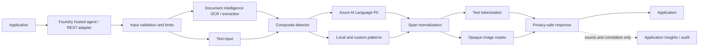

# Architecture

## Design goals

- Run deterministic protection before prompts reach generative models and after responses leave them.
- Keep original content in memory only and never place it in logs, traces, queues, or evaluation artifacts.
- Separate detectors, policy, redaction transforms, document extraction, hosting, and audit metadata.
- Use `DefaultAzureCredential` for local developer identity, workload identity, and managed identity.

## Request flow

## Service selection

| Capability | Service | Rationale |
| --- | --- | --- |
| Contextual PII | Azure AI Language | Names, addresses, identity categories, multilingual models |
| OCR and layout | Azure Document Intelligence | Word spans and polygons for documents and images |
| General visual objects | Azure AI Vision | Planned Image Redaction Agent |
| Multimodal schema extraction | Azure AI Content Understanding | Planned complex document policies; keep behind an adapter |
| Harm categories | Azure AI Content Safety | Planned Content Safety and prompt-attack controls |
| Agent hosting and lifecycle | Microsoft Foundry | Managed hosted-agent runtime, identity, telemetry, and evaluation |

## Extension contract

New detectors implement `PiiDetector.detect()`. New redactors consume normalized `DetectedEntity` spans. New hosting adapters call `PiiRedactionService`; they must not duplicate policy or emit source values.
