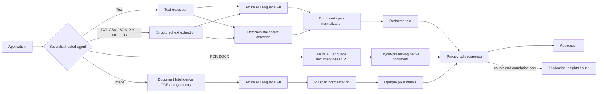

# Architecture

## Design goals

- Run deterministic protection before prompts reach generative models and after responses leave them.
- Keep original content in memory only and never place it in logs, traces, queues, or evaluation artifacts.
- Separate detection, policy, redaction transforms, hosting, and audit metadata.
- Use `DefaultAzureCredential` for local developer identity, workload identity, and managed identity.

## Request flow

## Service selection

| Capability | Service | Rationale |
| --- | --- | --- |
| Contextual PII | Azure AI Language | Names, addresses, identity categories, multilingual models |
| Runtime and structured-text secrets | Deterministic local signatures and entropy checks | Redacts credentials without transmitting matched values |
| Structured-document PII | Azure AI Language text PII | Combines PII and secret spans in UTF-8 text-based files |
| Native document PII | Azure AI Language document-based PII | Redacts PDF and DOCX while preserving native layout |
| Document extraction and OCR geometry | Azure Document Intelligence | Locates image words for the Image Redaction Agent |
| Image PII masking | Document Intelligence + Azure AI Language | Maps detected PII spans back to irreversible pixel masks |
| General visual objects | Azure AI Vision | Planned extension for non-text objects and faces |
| Multimodal schema extraction | Azure AI Content Understanding | Planned complex document policies; keep behind an adapter |
| Harm categories and prompt attacks | Microsoft Foundry Guardrails and Azure AI Content Safety | Platform controls configured on models and agents |
| Agent hosting and lifecycle | Microsoft Foundry | Managed hosted-agent runtime, identity, telemetry, and evaluation |

## Extension contract

PII detectors implement `PiiDetector.detect()`. Deterministic secret detectors return
the same internal `DetectedEntity` spans. Redactors consume normalized spans, and
hosting adapters call the relevant shared service without duplicating policy or
emitting source values. Secret detection covers runtime text and structured UTF-8
documents; native PDF/DOCX and image transformations remain PII-only.

## Layered PII detection pipeline

`PiiRedactionService` composes detectors behind the `PiiDetector` contract
(`shared/guardrails/pipeline.py`). Every enabled detector analyzes the same text and
returns `DetectedEntity` spans tagged with `source`, `category`, and offsets; the
`CompositePiiDetector` concatenates them and `normalize_entities` resolves overlap once
before redaction.

| Setting | Default | Effect |
| --- | --- | --- |
| `PII_ENABLE_AZURE_LANGUAGE` | `true` | Contextual PII via Azure AI Language (`azure-ai-language`) |
| `PII_CUSTOM_TERMS` | `[]` (JSON list) | Case-insensitive words/phrases on token boundaries (`custom-terms`, category `CustomTerm`, confidence 1.0) |
| `PII_ENABLE_SECRET_DETECTION` | `false` | Deterministic secret signatures (`deterministic-secret-detector`) |

Defaults reproduce the previous Azure-only text redaction. At least one detector must be
enabled.

**Precedence and overlap:** spans below the confidence threshold are dropped; overlaps
keep the highest confidence, then the longest span, then the earliest offset, then source
and category name, so results do not depend on detector order. Duplicate or overlapping
spans are therefore redacted once, and the winning span's source and category are reported.

**Limits:** Azure AI Language is probabilistic and may miss or mislabel context-free
values; custom terms are exact matches only (no fuzzy or semantic matching, and terms
must be at most 256 characters); secret rules cover known structures and keyword-assigned
high-entropy values, not arbitrary secrets. Matched values are never logged.

**Optional contextual detector:** a Foundry/GPT detector is not included because no
existing deployment configuration supports it. A future adapter can implement
`PiiDetector` and be added to the pipeline as an optional detector without affecting
deterministic coverage.
